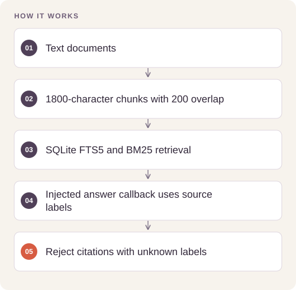

# Mission Document Intelligence

Answer questions about mission documentation using retrieved source passages and make answer quality inspectable.

## Implementation

A local SQLite FTS5 document index, configurable overlapping chunks, provider-neutral answer composition, and citation-label validation.




## Reproduce and inspect

The executable reproduction profile now records exact commands, input/source hashes, dependency versions, logs and pass/fail status. Its scope distinguishes behavior checks from full-data benchmarks.

[Commands, artifacts and benchmark scope](BENCHMARKS.md) · [Versioned profiles](reproduction.json)


## Try a small example

A fictional document and deterministic answer callback exercise retrieval and citation-label validation. Known source labels do not prove that an answer is entailed by its source.

After the local setup below, run from the repository root:

```sh
python examples/quickstart.py
```

The [example source](examples/quickstart.py), [captured output](examples/expected-output.txt) and [execution record](examples/environment.json) keep this demonstration inspectable. Floating-point values may vary with library versions.

Observed output from this run:

```text
{
  "answer": "An oxygen supply system [S1].",
  "sources": [
    {
      "citation": "S1",
      "source": "demo.txt"
    }
  ],
  "citation_present": true,
  "scope": "Citation validity checks labels, not factual entailment."
}
```

## Completed study

The completed study used a six-question evaluation harness and configurable ingestion. The public edition exposes retrieval and citation-checking components. This source release does not claim a new live-provider evaluation; generated responses and document-store state are not distributed.

These historical figures describe the completed study. This refactored standalone implementation has separate validation and has not been used to recertify the historical benchmark. The public release contains the portable core and focused tests.

## Run locally

Python 3.11 or later.

```sh
python -m venv .venv
source .venv/bin/activate
python -m pip install -r requirements.txt
python smoke_test.py
python document_intelligence.py /path/to/text_corpus "mission question"
```

Prepare your own inputs as described in [DATA.md](DATA.md). Tests use generated fixtures and do not need credentials or provider calls. [VALIDATION.md](VALIDATION.md) records their scope.

## Practical relevance and limitations

Retrieval can omit relevant evidence and an LLM judge can be wrong. Citations should be checked against the source. Live generation, embeddings, and judging require credentials and may incur provider charges.

## Reuse

The original contributions listed in [LICENSING.md](LICENSING.md) are available under [MIT](LICENSE). This scoped grant preserves upstream notices and separate dataset, simulator, notebook and checkpoint terms.
